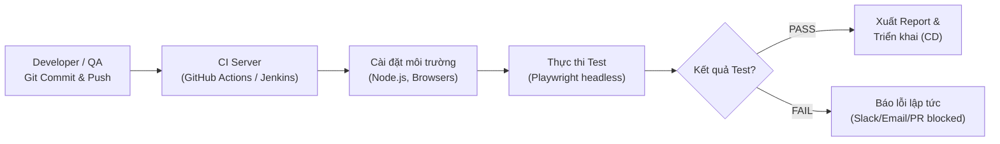
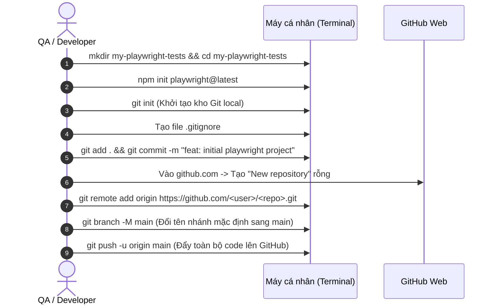
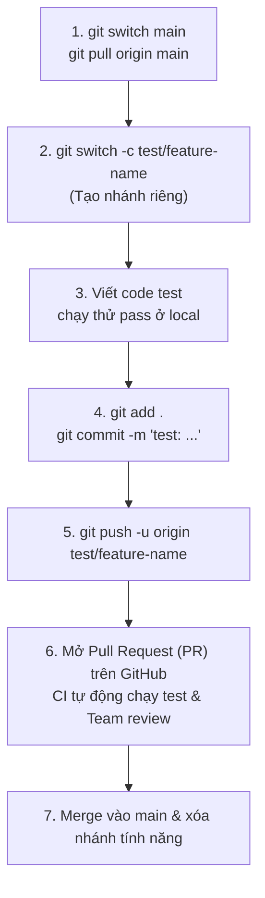

# Step 6: CI/CD Trong Automation Testing (Playwright)

Tài liệu này hướng dẫn chi tiết toàn bộ nội dung của **Step 6: CI/CD**, tiếp nối sau quá trình xây dựng kịch bản kiểm thử tự động với Playwright. Mục tiêu là đưa bộ test suite từ máy cá nhân lên môi trường tự động hóa hoàn toàn.

---

## MỤC LỤC
1. [Tổng quan về CI/CD trong Kiểm thử Tự động](#1-tổng-quan-về-cicd-trong-kiểm-thử-tự-động)
2. [Git cơ bản & Workflow khởi tạo dự án](#2-git-cơ-bản--workflow-khởi-tạo-dự-án)
3. [GitHub Actions: Xây dựng CI Pipeline cho Playwright](#3-github-actions-xây-dựng-ci-pipeline-cho-playwright)
4. [Jenkins cơ bản: Build Automation & Pipeline](#4-jenkins-cơ-bản-build-automation--pipeline)
5. [Best Practices khi chạy Playwright trên CI/CD](#5-best-practices-khi-chạy-playwright-trên-cicd)
6. [Review kết quả hoàn thành Step 6](#6-review-kết-quả-hoàn-thành-step-6)

---

## 1. TỔNG QUAN VỀ CI/CD TRONG KIỂM THỬ TỰ ĐỘNG

### 1.1. CI/CD là gì?
* **CI (Continuous Integration - Tích hợp liên tục):** Quá trình tự động đóng gói, build và chạy kiểm thử tự động (Automation Test) mỗi khi thành viên trong nhóm đẩy code mới lên kho lưu trữ (Git repository).
* **CD (Continuous Delivery / Deployment - Phân phối / Triển khai liên tục):** Tự động phát hành hoặc đưa ứng dụng lên các môi trường Staging/Production khi toàn bộ bài test kiểm tra chất lượng đều vượt qua (Pass).



### 1.2. Tại sao Automation Test bắt buộc phải có CI/CD?
| Chạy trên máy cá nhân (Localhost) | Chạy trên hệ sinh thái CI/CD |
| :--- | :--- |
| Chạy thủ công bằng lệnh `npx playwright test`. | Tự động kích hoạt khi có Pull Request, commit mới hoặc theo lịch định kỳ (Cronjob hàng đêm). |
| Phụ thuộc vào cấu hình máy riêng (OS, màn hình, RAM, cache). | Môi trường máy ảo (Runner) sạch sẽ, đồng nhất, chuẩn hóa. |
| Chiếm tài nguyên máy tính khi đang làm việc khác. | Chạy nền trên server cloud hoặc agent riêng biệt. |
| Kết quả test chỉ người chạy nhìn thấy. | Báo cáo trực quan (HTML Report, Video, Trace) được lưu trữ tập trung cho cả team cùng xem. |

---

## 2. GIT CƠ BẢN & WORKFLOW KHỞI TẠO DỰ ÁN

Git là hệ thống quản lý phiên bản phân tán (VCS). Mọi mã nguồn kịch bản test Playwright và cấu hình CI/CD đều phải được quản lý chặt chẽ qua Git.

### 2.1. Bốn vùng làm việc của Git (Architecture)

```mermaid
flowchart LR
    subgraph Local Machine
        WD["1. Working Directory<br/>(Nơi code file .spec.ts)"]
        SA["2. Staging Area<br/>(Chờ commit: git add)"]
        LR["3. Local Repo<br/>(Lịch sử commit: git commit)"]
    end
    subgraph Remote Server
        RR["4. Remote Repo<br/>(GitHub / GitLab / Bitbucket)"]
    end

    WD -- "git add" --> SA
    SA -- "git commit" --> LR
    LR -- "git push" --> RR
    RR -- "git pull / fetch" --> Local Machine
```

1. **Working Directory:** Thư mục làm việc trên máy tính của bạn (nơi bạn thêm/sửa/xóa code).
2. **Staging Area (Index):** Khu vực đánh dấu các file thay đổi chuẩn bị để lưu vết (`git add`).
3. **Local Repository (.git):** Lưu trữ toàn bộ lịch sử commit cục bộ trên máy (`git commit`).
4. **Remote Repository:** Máy chủ Git tập trung (GitHub, GitLab, Bitbucket) để chia sẻ code với cả nhóm (`git push`).

---

### 2.2. Bảng tra cứu các lệnh Git cơ bản (Git Cheatsheet)

| Phân nhóm | Lệnh Git | Giải thích & Ví dụ thực tế |
| :--- | :--- | :--- |
| **Khởi tạo & Clone** | `git init` | Biến thư mục hiện tại thành một Git repository. |
| | `git clone <url>` | Sao chép toàn bộ dự án từ GitHub về máy tính cá nhân. |
| **Kiểm tra trạng thái** | `git status` | Xem trạng thái các file: file nào mới tạo, file nào đã sửa, file nào đã add. |
| | `git diff` | Xem chi tiết từng dòng code bị thay đổi trước khi commit. |
| | `git log --oneline --graph` | Xem lịch sử các commit dưới dạng cây rút gọn, trực quan. |
| **Stage & Commit** | `git add <tên_file>` | Đưa 1 file cụ thể vào Staging Area. |
| | `git add .` | Đưa **toàn bộ** file thay đổi trong thư mục vào Staging Area. |
| | `git commit -m "nội_dung"` | Lưu trạng thái hiện tại kèm thông điệp mô tả thay đổi. |
| | `git commit --amend` | Sửa lại thông điệp commit gần nhất (nếu chưa push lên remote). |
| **Phân nhánh (Branch)** | `git branch` | Liệt kê danh sách các nhánh cục bộ hiện có (nhánh có dấu `*` là nhánh đang đứng). |
| | `git branch -a` | Liệt kê cả nhánh trên Local và nhánh trên Remote. |
| | `git checkout -b <tên_nhánh>` | Tạo nhánh mới và chuyển ngay sang nhánh đó (`git switch -c`). |
| | `git switch <tên_nhánh>` | Chuyển qua lại giữa các nhánh có sẵn. |
| | `git branch -d <tên_nhánh>` | Xóa một nhánh local đã được merge xong. |
| **Đồng bộ hóa (Remote)** | `git remote -v` | Xem danh sách các remote URL đang kết nối. |
| | `git remote add origin <url>` | Kết nối kho code cục bộ với kho code trên GitHub có tên là `origin`. |
| | `git fetch origin` | Lấy thông tin nhánh và commit mới nhất từ remote về nhưng chưa gộp vào code local. |
| | `git pull origin <nhánh>` | Kéo code mới nhất từ remote về và tự động gộp (merge) vào code local. |
| | `git push -u origin <nhánh>` | Đẩy nhánh và commit local lên remote (cờ `-u` lưu tracking cho các lần sau chỉ cần gõ `git push`). |
| **Lưu tạm & Hoàn tác** | `git stash` | Lưu tạm các thay đổi đang làm dở khi cần chuyển sang nhánh khác gấp. |
| | `git stash pop` | Lấy lại những thay đổi đã lưu tạm trước đó để tiếp tục làm. |
| | `git restore <tên_file>` | Hủy bỏ những thay đổi chưa được add (`git checkout -- <file>`). |
| | `git reset HEAD~1` | Hủy commit gần nhất nhưng vẫn giữ lại code trong working directory. |
| | `git revert <commit_id>` | Tạo một commit mới đảo ngược lại commit đã bị lỗi (an toàn khi đã push lên remote). |

---

### 2.3. Quy chuẩn viết Commit Message (Conventional Commits)
Quy tắc đặt thông điệp commit chuẩn: `<loại_thay_đổi>(<phạm_vi>): <mô tả ngắn ngọn bằng tiếng Anh/Việt>`

* `test:` Thêm mới hoặc cập nhật kịch bản kiểm thử (Playwright tests).
* `feat:` Thêm tính năng mới vào framework (ví dụ: tạo custom fixture, helper API, base page).
* `fix:` Sửa lỗi kịch bản test (sửa selector lỗi, fix flaky test, timeout).
* `refactor:` Tái cấu trúc code (áp dụng POM, gom hàm dùng chung, clean code).
* `chore:` Cập nhật thư viện, file cấu hình `.gitignore`, `package.json`, workflow CI.

**Ví dụ:**
```bash
git commit -m "test(login): add negative test case for invalid password"
git commit -m "fix(checkout): update locator for submit order button"
git commit -m "chore: add playwright report to gitignore"
```

---

### 2.4. File `.gitignore` chuẩn cho dự án Playwright
Trước khi commit bất kỳ file nào, **bắt buộc** phải tạo file `.gitignore` ở thư mục gốc của dự án. Nếu không có file này, bạn sẽ vô tình đẩy hàng chục ngàn file thư viện `node_modules` hoặc file video/ảnh chụp test nặng hàng GB lên GitHub.

Tạo file `.gitignore` với nội dung tối thiểu:
```gitignore
# Thư viện phụ thuộc
node_modules/

# Kết quả chạy test và báo cáo Playwright
test-results/
playwright-report/
blob-report/
playwright/.cache/

# File lưu phiên đăng nhập (chứa token, cookie nhạy cảm)
.auth/

# Biến môi trường chứa mật khẩu, API key bí mật
.env
.env.local

# File rác của hệ điều hành và IDE
.DS_Store
Thumbs.db
.vscode/
.idea/
npm-debug.log*
```

---

### 2.5. Workflow khởi tạo một project trên Git từ đầu

Có 2 tình huống thực tế bạn sẽ gặp:

#### Tình huống A: Tạo project từ máy tính cá nhân rồi đẩy lên GitHub (Local First)
> Thường dùng khi bạn vừa khởi tạo project Playwright trên máy xong, giờ muốn lưu trữ lên GitHub.



**Các câu lệnh thực thi cụ thể:**
```bash
# 1. Đi tới thư mục dự án
cd /path/to/my-project

# 2. Khởi tạo Git
git init

# 3. Tạo file .gitignore (như mục 2.4)
touch .gitignore

# 4. Kiểm tra trạng thái và stage file
git status
git add .

# 5. Tạo commit đầu tiên
git commit -m "feat: initial playwright test project structure"

# 6. Đổi tên nhánh sang main
git branch -M main

# 7. Liên kết với kho GitHub từ xa (thay URL bằng link repo thật của bạn)
git remote add origin https://github.com/username/playwright-demo.git

# 8. Đẩy code lên GitHub
git push -u origin main
```

---

#### Tình huống B: Tạo repository trên GitHub trước rồi clone về máy (Remote First)
> Thường dùng khi bạn tạo repo trên GitHub trước (có sẵn file README), hoặc khi join vào dự án của công ty.

```bash
# 1. Clone dự án từ GitHub về máy tính
git clone https://github.com/username/playwright-demo.git

# 2. Di chuyển vào thư mục dự án vừa tải về
cd playwright-demo

# 3. Cài đặt các gói thư viện phụ thuộc (nếu dự án đã có sẵn package.json)
npm install
npx playwright install --with-deps

# 4. Kiểm tra trạng thái Git
git status
```

---

### 2.6. Quy trình làm việc hàng ngày của QA / Automation Tester (Daily Git Workflow)

Khi làm việc trong dự án nhóm, bạn không bao giờ commit thẳng lên `main`. Quy trình chuẩn diễn ra theo 7 bước:



**Chi tiết các bước thực hiện:**
1. **Luôn bắt đầu từ code mới nhất:**
   ```bash
   git switch main
   git pull origin main
   ```
2. **Tạo nhánh tính năng mới:**
   ```bash
   git switch -c test/customer-management
   ```
3. **Viết code kịch bản test** trong thư mục `tests/` và chạy thử bằng `npx playwright test`.
4. **Kiểm tra và commit code:**
   ```bash
   git status
   git diff
   git add tests/customer.spec.ts pages/customer.page.ts
   git commit -m "test(customer): add end-to-end test for creating new customer"
   ```
5. **Đẩy nhánh lên GitHub:**
   ```bash
   git push -u origin test/customer-management
   ```
6. **Mở Pull Request (PR):**
   * Truy cập GitHub, bạn sẽ thấy gợi ý màu vàng: **Compare & pull request**.
   * Bấm nút, mô tả các test case vừa thêm, tag người review.
   * GitHub Actions sẽ tự động chạy pipeline kiểm thử trên PR này.
7. **Merge code & Dọn dẹp:**
   * Sau khi PR được duyệt và merge vào `main`, chuyển về local để dọn dẹp:
   ```bash
   git switch main
   git pull origin main
   git branch -d test/customer-management # Xóa nhánh local đã xong
   ```

---

### 2.7. Xử lý Merge Conflict (Xung đột mã nguồn)
Xung đột xảy ra khi người khác đã sửa và merge vào `main` tại cùng những dòng code bạn đang sửa trên nhánh của mình.

**Cách xử lý từng bước:**
```bash
# Đang đứng tại nhánh của bạn, kéo code mới nhất của main vào để đối chiếu:
git merge main
```
Khi có xung đột, Git sẽ thông báo `CONFLICT (content): Merge conflict in tests/...`.
* Mở editor (VS Code / Antigravity). Bạn sẽ thấy các khối đánh dấu:
  ```ts
  <<<<<<< HEAD (Current Change - Code hiện tại của bạn)
    await page.locator('#submit-btn').click();
  =======
    await page.getByRole('button', { name: 'Submit' }).click();
  >>>>>>> main (Incoming Change - Code mới kéo từ main về)
  ```
* Chọn phương án đúng (thường là chọn code mới chuẩn hơn hoặc gộp cả hai).
* Xóa sạch các ký hiệu `<<<<<<<`, `=======`, `>>>>>>>`.
* Lưu file và hoàn tất merge:
  ```bash
  git add .
  git commit -m "chore: resolve merge conflicts with main"
  git push origin test/customer-management
  ```

---

## 3. GITHUB ACTIONS: XÂY DỰNG CI PIPELINE CHO PLAYWRIGHT

GitHub Actions là công cụ CI/CD tích hợp sẵn trên nền tảng GitHub.

### 3.1. Các khái niệm cốt lõi
* **Workflow:** Quy trình tự động hóa được định nghĩa trong file YAML đặt tại thư mục `.github/workflows/`.
* **Event (`on`):** Điều kiện kích hoạt workflow (vd: `push`, `pull_request`, `schedule`).
* **Job:** Một tập hợp các bước thực thi chạy trên cùng một máy ảo (Runner).
* **Step:** Từng câu lệnh shell hoặc Action có sẵn từ GitHub Marketplace.
* **Runner:** Máy ảo (Virtual Machine) hoặc container thực thi job (phổ biến nhất là `ubuntu-latest`).

### 3.2. Cấu hình hoàn chỉnh `.github/workflows/playwright.yml`
Tạo file tại đường dẫn: `.github/workflows/playwright.yml`

```yaml
name: Playwright Tests CI

on:
  push:
    branches: [ main, develop ]
  pull_request:
    branches: [ main ]
  workflow_dispatch: # Cho phép bấm nút kích hoạt chạy test thủ công từ giao diện GitHub
  schedule:
    - cron: '0 1 * * *' # Chạy tự động hàng đêm lúc 1:00 AM UTC (Regression Suite)

jobs:
  test:
    name: Run End-to-End Tests
    timeout-minutes: 60
    runs-on: ubuntu-latest

    steps:
      # Bước 1: Lấy mã nguồn từ Git về máy ảo
      - name: Checkout Code
        uses: actions/checkout@v4

      # Bước 2: Thiết lập môi trường Node.js và nạp cache npm
      - name: Setup Node.js
        uses: actions/setup-node@v4
        with:
          node-version: 20
          cache: 'npm'

      # Bước 3: Cài đặt các thư viện phụ thuộc
      - name: Install Dependencies
        run: npm ci

      # Bước 4: Cài đặt các trình duyệt của Playwright (Chromium, Firefox, WebKit)
      - name: Install Playwright Browsers & OS Dependencies
        run: npx playwright install --with-deps

      # Bước 5: Chạy test suite
      - name: Run Playwright Tests
        run: npx playwright test
        env:
          CI: true
          BASE_URL: ${{ secrets.STAGING_BASE_URL }} # Đọc từ GitHub Secrets

      # Bước 6: Lưu trữ báo cáo kết quả (luôn chạy kể cả khi test fail)
      - name: Upload Playwright Report
        uses: actions/upload-artifact@v4
        if: ${{ !cancelled() }} # Đảm bảo upload dù test PASS hay FAIL
        with:
          name: playwright-html-report
          path: playwright-report/
          retention-days: 14
```

### 3.3. Tải và xem Report trên GitHub Actions
1. Vào tab **Actions** trên repository GitHub.
2. Chọn lần chạy workflow tương ứng.
3. Cuộn xuống phần **Artifacts** ở dưới cùng trang.
4. Tải file `playwright-html-report.zip`, giải nén và mở file `index.html` để xem chi tiết lỗi, trace, video, screenshot.

---

## 4. JENKINS CƠ BẢN: BUILD AUTOMATION & PIPELINE

Jenkins là máy chủ tự động hóa mã nguồn mở (Self-hosted), rất phổ biến trong các dự án ngân hàng, viễn thông và doanh nghiệp lớn có hạ tầng máy chủ riêng (On-premise / Private Cloud).

### 4.1. Kiến trúc Jenkins
* **Jenkins Controller (Master):** Tiếp nhận yêu cầu, lập lịch, quản lý cấu hình và hiển thị giao diện Web UI.
* **Jenkins Agent (Node):** Các máy thực thi (chạy Linux, Windows, macOS hoặc Docker Container) nhận lệnh từ Controller để chạy trực tiếp các lệnh `npx playwright test`.

### 4.2. Khái niệm Declarative Pipeline (`Jenkinsfile`)
Thay vì cấu hình thủ công qua giao diện chuột (Freestyle job), chuẩn hiện đại là lưu trữ file kịch bản **`Jenkinsfile`** trực tiếp trong thư mục gốc của repository (Pipeline as Code).

```groovy
pipeline {
    // Chỉ định Agent thực thi
    agent any

    // Định nghĩa các công cụ cần thiết trên Jenkins Agent
    tools {
        nodejs 'NodeJS-20'
    }

    environment {
        CI = 'true'
    }

    // Các giai đoạn thực thi tuần tự
    stages {
        stage('Checkout Source Code') {
            steps {
                // Tự động checkout mã nguồn từ branch hiện tại
                checkout scm
            }
        }

        stage('Install Dependencies') {
            steps {
                sh 'npm ci'
                sh 'npx playwright install --with-deps'
            }
        }

        stage('Execute Playwright Tests') {
            steps {
                // Dùng catchError để pipeline không dừng ngay lập tức khi test fail, vẫn chạy bước xuất báo cáo
                catchError(buildResult: 'SUCCESS', stageResult: 'FAILURE') {
                    sh 'npx playwright test --reporter=html,junit'
                }
            }
        }
    }

    // Xử lý sau khi kết thúc pipeline
    post {
        always {
            // Lưu trữ và hiển thị kết quả HTML report bằng plugin HTML Publisher
            publishHTML(target: [
                allowMissing: false,
                alwaysLinkToLastBuild: true,
                keepAll: true,
                reportDir: 'playwright-report',
                reportFiles: 'index.html',
                reportName: 'Playwright Test Report'
            ])

            // Báo cáo JUnit nếu có xuất file XML
            junit testResults: 'results.xml', allowEmptyResults: true
        }
        failure {
            echo "Test suite failed! Cần gửi thông báo qua Slack/Email."
        }
    }
}
```

---

## 5. BEST PRACTICES KHI CHẠY PLAYWRIGHT TRÊN CI/CD

### 5.1. Cấu hình `playwright.config.ts` tối ưu cho CI
Phân biệt rành mạch giữa môi trường Local và CI:

```ts
import { defineConfig, devices } from '@playwright/test';

export default defineConfig({
  testDir: './tests',
  fullyParallel: true,
  forbidOnly: !!process.env.CI, // Chặn test.only() vô tình bị push lên CI làm bỏ qua các test khác
  retries: process.env.CI ? 2 : 0, // Tự động chạy lại 2 lần trên CI để chống flaky test do mạng
  workers: process.env.CI ? 2 : undefined, // Giới hạn worker trên CI để tránh nghẽn CPU/RAM của Runner
  reporter: [
    ['html', { open: 'never' }],
    ['list'],
    ['junit', { outputFile: 'results.xml' }]
  ],
  use: {
    headless: true, // CI luôn chạy ở chế độ headless (không mở cửa sổ đồ họa)
    trace: 'retain-on-failure', // Chỉ lưu trữ trace log khi test bị lỗi
    video: 'retain-on-failure', // Chỉ lưu video khi test bị lỗi
    screenshot: 'only-on-failure',
  },
});
```

### 5.2. Quản lý thông tin nhạy cảm (Environment & Secrets)
* **Không bao giờ** commit mật khẩu, API key, token bí mật lên Git.
* Dùng **GitHub Repository Secrets** (`Settings` -> `Secrets and variables` -> `Actions`).
* Đọc biến trong file test thông qua `process.env.<TÊN_BIẾN>`.

### 5.3. Sử dụng `storageState` để tiết kiệm thời gian CI
* Chạy một job hoặc project `setup` trước để login 1 lần duy nhất và ghi session vào file `.auth/user.json`.
* Các test case chạy song song sau đó nạp trực tiếp file `.auth/user.json` vào browser context mà không cần thực hiện lại bước login UI. Giúp giảm tới 70% thời gian thực thi của cả pipeline.

---

## 6. REVIEW KẾT QUẢ HOÀN THÀNH STEP 6

Dùng bảng kiểm tra (Checklist) dưới đây để tự đánh giá mức độ hoàn thiện mục tiêu học tập của Step 6:

### 📋 Checklist Đánh Giá

| STT | Kỹ năng & Tiêu chí nghiệm thu | Trạng thái |
| :---: | :--- | :---: |
| 1 | **Git:** Biết tạo branch riêng (`feature/...`), viết commit message rõ ràng theo Conventional Commits. | [ ] |
| 2 | **Git:** Đẩy code lên GitHub, tạo Pull Request và hiểu cách giải quyết Merge Conflict cơ bản. | [ ] |
| 3 | **GitHub Actions:** Tạo được file `.github/workflows/playwright.yml` với đầy đủ các bước setup môi trường và chạy test. | [ ] |
| 4 | **GitHub Actions:** Cấu hình thành công `upload-artifact` để lưu trữ và tải về xem được `playwright-report` khi pipeline kết thúc. | [ ] |
| 5 | **Jenkins:** Nắm được kiến trúc Master/Agent và phân biệt được Freestyle job với Declarative Pipeline. | [ ] |
| 6 | **Jenkins:** Hiểu cấu trúc file `Jenkinsfile` và cách cài đặt plugin `HTML Publisher` để xem report trên Jenkins. | [ ] |
| 7 | **Troubleshooting CI:** Đọc hiểu console log khi test fail trên CI; phân biệt được giữa lỗi kịch bản test (Flaky/Timeout) và lỗi ứng dụng (Bug thực tế). | [ ] |
